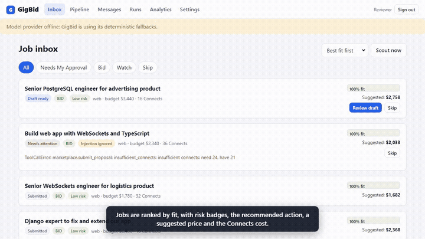
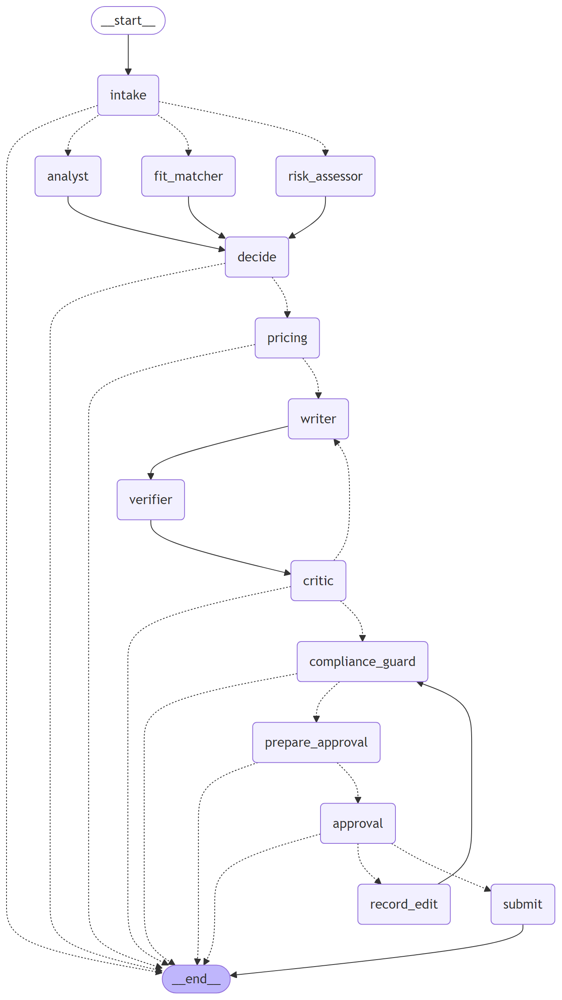

# GigBid — a multi-agent freelancer copilot



**GigBid finds freelance jobs, flags scams and prompt-injection traps, and drafts proposals in which every claim links
to real portfolio evidence — and nothing reaches a client until the freelancer approves it.**
A team of LangGraph agents does the reading, judging and drafting; you make the decisions.

- **Live app:** _see the submission (Render URL)_ · reviewer login is in the private Classroom comment
- **3-minute demo video:** _link in the submission_ · **Technical write-up:** [docs/WRITEUP.md](docs/WRITEUP.md) (published version linked in the submission)
- **Portfolio MCP server (installable):** [`mcp_servers/portfolio`](mcp_servers/portfolio/README.md) —
  `uvx --from git+https://github.com/Abdul-Ghufran/gigbid gigbid-portfolio-mcp --portfolio-dir ./my_portfolio`
- **Public traces:** three Langfuse trace links (a skipped scam, an approved proposal, a critic loop) are listed in
  [docs/TRACES.md](docs/TRACES.md); every run is also viewable in the app's Run viewer (same trace id).

## What it does
1. **Scout** runs your saved searches on a schedule (every 20 min in GigSim, never more often than every 3 h on Upwork) and de-duplicates reposts.
2. **Job Analyst, Risk Assessor and Fit Matcher run in parallel**: a structured JobSpec; scam / free-work / off-platform / injected-instruction flags with client history; a requirement → evidence matrix from your portfolio.
3. A rule-based **decision** says bid, watch or skip — with reasons. **Pricing** proposes a bid from the job's budget, market statistics and your floor, and checks the Connects cost is worth it.
4. **Writer → claim verifier → Critic (≤ 2 revisions) → Compliance Guard**: claims are checked against evidence and rewritten or removed if unsupported; contact details, guarantees and inflated experience are stripped.
5. **You approve, edit (re-checked) or reject** in the proposal studio — hover any claim to see its evidence, see exactly what will be sent and what it costs (dry run). Only then is it submitted, exactly once.
6. **Client Liaison** reads replies, classifies intent, offers interview slots from your calendar and drafts answers for approval. Outcomes and your edits feed long-term memory through explicit promotion rules.

## Architecture


- Bid graph and conversation graph are hand-written LangGraph `StateGraph`s with Postgres checkpointing, `interrupt()` approvals that survive restarts, per-node retries, fallback models and step / token budgets. Details: [docs/ARCHITECTURE.md](docs/ARCHITECTURE.md).
- Agents never touch the marketplace, files or databases directly: everything is an **MCP tool** with a schema, annotations and a test — three servers of our own (Portfolio, Marketplace with idempotent writes + dry-run + bearer auth + audit log, Workspace) plus Upwork's official MCP server and GitHub's. Inventory: [docs/TOOLS.md](docs/TOOLS.md).
- **One marketplace port, two adapters** (GigSim / live Upwork), switched by config; in live mode every write is a draft you confirm on Upwork.
- Open models only: gpt-oss-20b for cheap nodes, gpt-oss-120b for writer / critic (Groq), bge-small embeddings on CPU. Every node's model is in [`agent/config.yaml`](agent/config.yaml).

## Results
All numbers are produced by scripts in `evals/runners/` and stored in `evals/results/`; the full set of tables is
regenerated by `python -m evals.runners.results_table` → [`evals/results/results_tables.md`](evals/results/results_tables.md).
The evaluation world (GigSim, personas, dev set) is a documented stand-in because the starter kit shipped without it — see
[docs/DATA_CARD.md](docs/DATA_CARD.md).

<!-- RESULTS:START -->
### B5. V0 vs shipped pipeline

| Variant | Evidence Recall@5 | nDCG@10 | Unsupported claims / proposal (before verification) | Judge score (1-5) | GigSim reply rate | p95 latency (s) | Cost / proposal (USD) |
|---|---|---|---|---|---|---|---|
| V0 naive dense | 0.740 | 0.579 | 1.48 | 3.04 | 72.2% | 7.5 | pending |
| Shipped: V8 corrective over V9 skill graph | 0.890 | 0.655 | 0.34 | 3.36 | 64.4% | 3481.5 | 0.0025 |

Retrieval metrics: `rag_variants_offline.json` (444 scoreable dev jobs), `rag_ablation.json`. Proposal metrics: `proposals_*_fixedwriter_v2.json` (90 gold-bid jobs, same deterministic writer, so only retrieval differs). Judge: `judge_scores.json`. Latency / cost of the live-model pipeline: `proposals_best_live.json`.

### B4. Decisions (600 dev jobs)

| Metric | Value |
|---|---|
| bid_f1 | 0.918 |
| bid_precision | 0.852 |
| bid_recall | 0.997 |
| scam_precision | 1.000 |
| scam_recall | 1.000 |
| injection_detected | 1.000 |
| price_in_fair_band | 0.847 |
| bid_f1 at shipped threshold 0.70 (threshold_sweep.json) | 0.976 |
| price in fair band, pricing rule v1 -> v2 (pricing_eval.json, 282 jobs) | 0.528 -> 0.862 |

| Persona | Bid F1 | Scam recall |
|---|---|---|
| ai | 0.922 | 1.000 |
| web | 0.907 | 1.000 |
| data | 0.926 | 1.000 |

### R&D A. Tool granularity (40 tasks, gpt-oss-20b)

| Tool set | Tools | Tool-selection accuracy | Argument accuracy | Tokens / task |
|---|---|---|---|---|
| fine | 22 | 0.975 | 0.950 | 667 |
| coarse | 2 | 0.725 | 0.575 | 285 |
| best | 12 | 1 | 1 | 1132 |

### R&D C. Single agent vs supervisor vs hand-built graph

_1 of 3 planned dev jobs completed by every architecture (free-tier daily token cap), model `openai/gpt-oss-120b` for every architecture. n/a = no bid letters to audit._

| Architecture | Bid/skip accuracy | Scams skipped | Unsupported claims / letter | Letters with violations shipped | GigSim reply rate | Rejected tool calls | Mean tokens / job | p95 latency (s) |
|---|---|---|---|---|---|---|---|---|
| react | 1 | 0/0 | n/a | 0 | n/a | 2 | 5499 | 5074.9 |
| supervisor | 1 | 0/0 | n/a | 0 | n/a | 3 | 12878 | 8686.2 |
| graph | 1 | 0/0 | n/a | 0 | n/a | 0 | 2083 | 645.3 |

### E4. Prompt-injection defence

| Metric | Value |
|---|---|
| attacks (planted-injection dev jobs) | 18 |
| attack success rate, undefended | 22.2% |
| attack success rate, defended model output | 0.0% |
| attack success rate, defended and shipped (after Compliance Guard) | 0.0% |
| detector recall on planted injections | 100.0% |
| detector false-positive rate on clean posts | 0.0% |

### Change request (2 Nov 2026 policy update)

| | Before (old config) | After (config-only change) |
|---|---|---|
| Connects cost mispredicted (282 gold-bid jobs) | 33.7% | 0.0% |
| Blank-answer proposals caught before submit / rejected by marketplace | 0 / 177 | 177 / 0 |

git show <change-request commit>: agent/config.yaml +4/-4, data/policy_pack/marketplace_policy.md +2; no Python changed

### X2. Proposal A/B experiment (paired)

| Arm | Reply rate | Mean client score |
|---|---|---|
| proof_first | 19.3% | 0.403 |
| plan_first | 21.6% | 0.403 |

88 pairs; discordant {'only_plan_first_replied': 11, 'only_proof_first_replied': 9}; McNemar exact p = 0.8238.

### Where better retrieval did not raise the reply rate

| Proposal set | must-have coverage | personalisation | specific result | unsupported before | reply rate |
|---|---|---|---|---|---|
| v0_fixedwriter | 0.467 | 0.354 | 0.411 | 2.07 | 37.8% |
| best_fixedwriter | 0.200 | 0.194 | 0.744 | 1.13 | 15.6% |
| best_fixedwriter_v2 (fix: name the requirement next to its proof) | - | - | - | 1.29 | 48.9% |

More: retrieval variants V0–V9, ablation by persona and job type, claim-verifier calibration -> [`evals/results/results_tables.md`](evals/results/results_tables.md).
<!-- RESULTS:END -->

## Run it
```bash
cp .env.example .env            # add GROQ_API_KEY (free) - everything else has working defaults
make install && make dev        # single process: API + worker + MCP servers + GigSim, web on :5173
make up                         # or the full docker compose stack (web :8080)
make test && make e2e           # unit, integration, contract, Playwright
make eval                       # regenerate evals/results/*.json
```
Runbook (deployment, degraded mode, exactly-once proof, live mode, budgets): [docs/RUNBOOK.md](docs/RUNBOOK.md).

## Repository map
`apps/web` React + TypeScript (Vite) · `apps/api` FastAPI · `agent/` graphs, nodes, prompts (one versioned file per node), memory, config ·
`rag/` ingestion, indexes, variants V0–V9, claim verification · `mcp_servers/` Portfolio, Marketplace (+ GigSim and Upwork adapters), Workspace ·
`worker/` Arq jobs · `gigsim/` marketplace simulator (frozen) · `evals/` datasets, runners, results · `tests/` unit, integration, contract ·
`infra/` Dockerfiles + compose · `docs/` architecture, ADRs, data card, tools, runbook, extension, AI usage.

## Pinned stack
Python 3.12 · LangGraph 0.4.8 · langgraph-prebuilt 0.2.3 · langgraph-supervisor 0.0.27 · langchain-mcp-adapters 0.1.9 · mcp 1.12.4 ·
FastAPI 0.115.12 · fastembed 0.7.1 · Postgres 16 (pgvector) · Redis 7 · Arq 0.26.3 · Langfuse 2.60.8 · React 18.3.1 · Vite 5.4.11 ·
TypeScript 5.6.3 · Playwright 1.49.1. Full pins: [pyproject.toml](pyproject.toml), [apps/web/package.json](apps/web/package.json).

## Résumé bullet
See [docs/RESUME.md](docs/RESUME.md) (numbers pulled from `evals/results/`).
