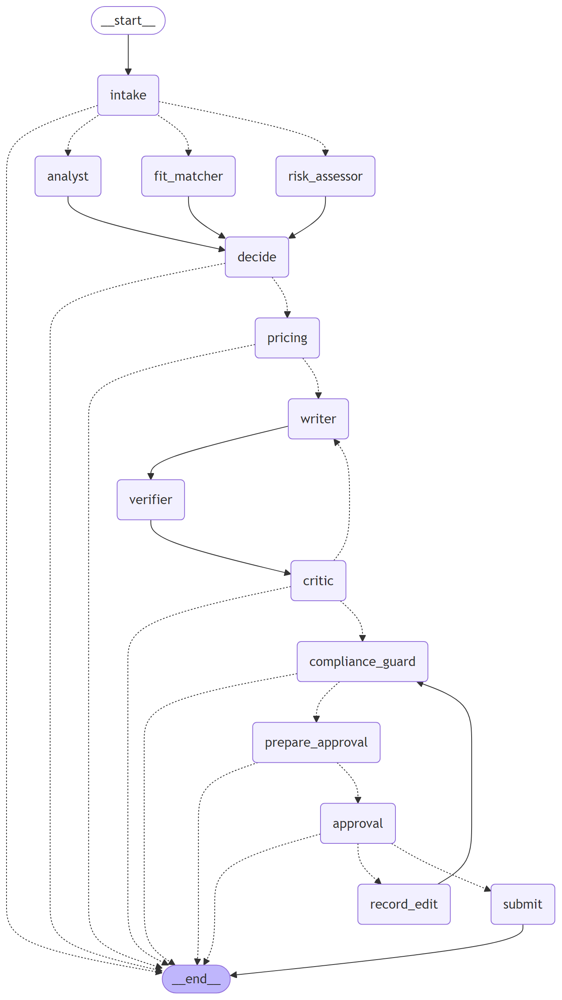
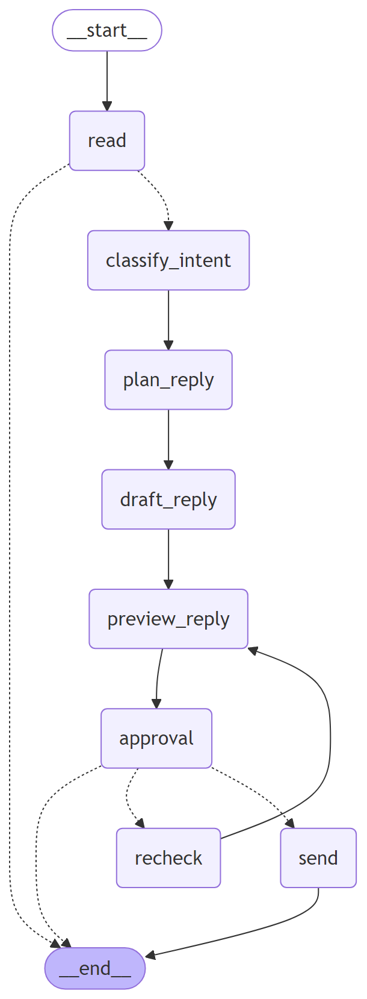

# Architecture

```
 Web (React + TS, Vite)  ──HTTP/SSE──>  FastAPI (apps/api)  ──enqueue──>  Worker (Arq on Redis; in-process fallback)
                                             │                                   │
                                             │            LangGraph: bid graph · conversation graph
                                             │            Postgres checkpointer + LangGraph store (memory)
                                             ▼                                   ▼
                                   MCP client (agent/mcp_client.py: per-agent allowlists, timeouts, retries)
                     ┌───────────────────────┼─────────────────────────────┐
              Portfolio MCP            Marketplace MCP                 Workspace MCP
         (search_evidence, case      (search/get jobs, client         (free slots, holds,
          studies, skills; RAG)       history, connects, drafts,       email drafts)
                                       submit, messages)
                                            │ one port, two adapters (config: marketplace.mode)
                                 ┌──────────┴──────────┐
                           GigSim adapter          Upwork live adapter ──> Upwork official MCP (OAuth 2.1)
                           (REST, rate limit,      (drafts only; user confirms on Upwork)
                            retries, idempotency)
```

## Bid graph (one thread per job)


`intake` (Scout) → **Send** to `analyst` ∥ `risk_assessor` ∥ `fit_matcher` → `decide` (skip / watch / bid) →
`pricing` → `writer` → `verifier` → `critic` (back to the writer at most twice) → `compliance_guard` →
`prepare_approval` (dry-run previews) → `approval` (**interrupt**) → `submit` | `record_edit` → `compliance_guard` | END.
Rendered from code by `tools/render_graphs.py` (`docs/images/bid_graph.mmd`).

## Conversation graph (one thread per client conversation)


`read` → `classify_intent` (question / negotiation / interview_request / acceptance / scam_signal) → `plan_reply`
(calendar slots from the Workspace MCP for interview requests; walk-away price rule for negotiations) → `draft_reply` →
`preview_reply` (dry run) → `approval` (**interrupt**) → `send` (+ tentative calendar holds) | `recheck` | END.

## Why each agent exists
| Agent | Why it is its own node | Model (open profile) | MCP access |
|---|---|---|---|
| Scout | runs on a schedule outside any request; dedup by fingerprint makes processing idempotent | none | marketplace read |
| Job Analyst | turns free text into a JobSpec every later step can trust | gpt-oss-20b | none |
| Risk Assessor | cheap, rule-first gate: scams never reach the expensive writer | gpt-oss-20b (rules are a floor) | marketplace read |
| Fit Matcher | requirement → evidence matrix; its "unsupported" list is what the writer must not claim | none (retrieval) | portfolio read |
| Pricing Strategist | deterministic, auditable price + Connects expected-value rule | none | marketplace read |
| Proposal Writer | the only creative step, so it gets the strongest model | gpt-oss-120b | portfolio read |
| Claim verifier | independent check after writing: rewrite or remove unsupported claims (B3) | gpt-oss-20b for rewrites | portfolio read |
| Critic | bounded quality loop; deterministic checks first so obvious failures cost no LLM call | gpt-oss-120b | portfolio read |
| Compliance Guard | policy pack enforcement on every outgoing text, including user edits | gpt-oss-20b + filters | marketplace policy |
| Client Liaison | conversations have different state, cadence and risks than bids | gpt-oss-120b | marketplace + workspace |

The roles were kept separate because R&D question C measured what merging them costs (`evals/results/rq_c_architectures.json`).

## State, trace and memory are kept apart (C2)
- **State** (`agent/state.py`): typed `BidState` / `ConversationState` with separate fields for job, analyses, evidence,
  decision, price, draft, verification, critiques, compliance, approvals, submission; reducers (`merge_dicts`,
  `operator.add`) wherever the parallel branches write.
- **Execution trace**: every node start/end, tool name, arguments, result and LLM generation → `RunEvent` rows (run viewer,
  SSE), the MCP append-only `audit_log` (Postgres trigger forbids UPDATE/DELETE) and Langfuse. One trace id flows from the
  UI request (`X-Trace-Id`) through the API, the graph, every MCP call and the audit log. PII is masked before it is stored.
- **Long-term memory** (`agent/memory/`): LangGraph store namespaces `("style", user)` and `("outcome", user, category)`,
  written **only** by `promotion_rules.py` (style: same edit pattern in ≥ 3 edits across ≥ 3 jobs in 30 days; outcome: ≥ 5
  outcomes and ≥ 10-point reply-rate lift). Raw edits live in the `edits` table, not in memory; the UI can delete memory items
  and deleted rules are never re-promoted.

## Durability and failure handling (C6, C7)
- Postgres checkpointer (`AsyncPostgresSaver`) and store; a thread paused at `interrupt()` survives API/worker restarts.
- Exactly-once submission: draft and submit use idempotency keys derived from (user, job, content hash); a replayed submit
  returns the stored result and never spends Connects twice (`tests/integration/test_graphs.py::test_crash_while_waiting_then_resume_submits_exactly_once`).
- `history` / `replay_from` expose checkpoint history and replay from any node (`/api/jobs/{id}/history`, `/replay`).
- Per-node `RetryPolicy` + timeouts; fallback model for every node (configured per profile) and a deterministic offline
  path when no model is reachable; step and token budgets per thread → visible `needs_attention`; `MarketplaceDown` →
  `queued_retry` (UI banner, automatic retry); 3 failed runs → `dead_letter`.

## Stores
| Store | What | Where |
|---|---|---|
| Postgres (Neon in production) | users, settings, encrypted marketplace tokens, inbox jobs, runs + run events, audit log, idempotency, uploads, edits, workspace items, LangGraph checkpoints + store, GigSim state | `common/db.py`, `agent/runner.py` |
| Vector store | dense corpus vectors (fastembed bge-small, 384-d) with an on-disk cache baked into the image; pgvector is available in compose | `rag/index/core.py` |
| Redis | Arq job queue (compose); the 512 MB Render deployment runs the worker in-process instead (see RUNBOOK) | `worker/tasks.py` |
