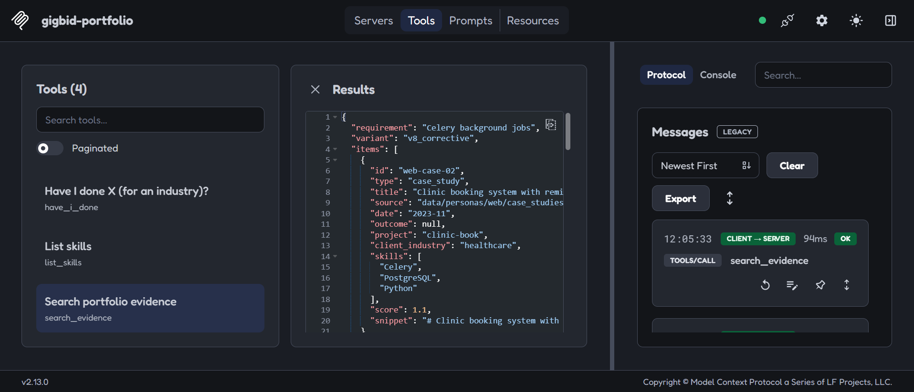
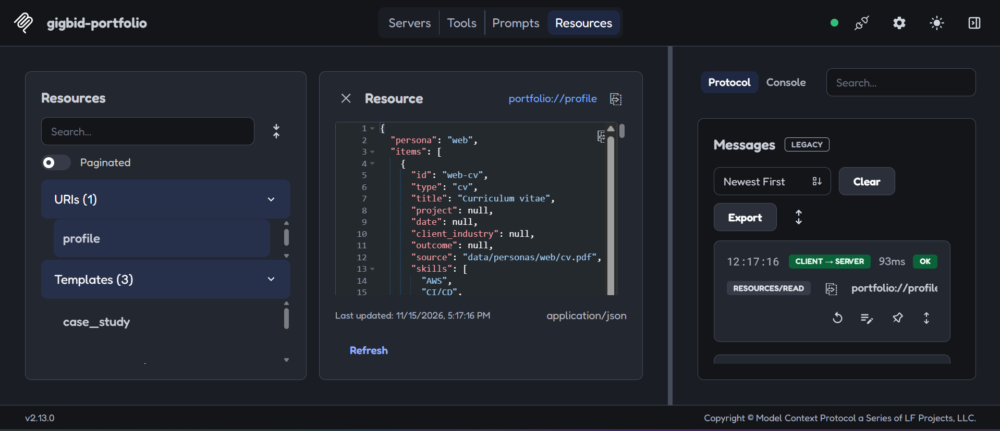
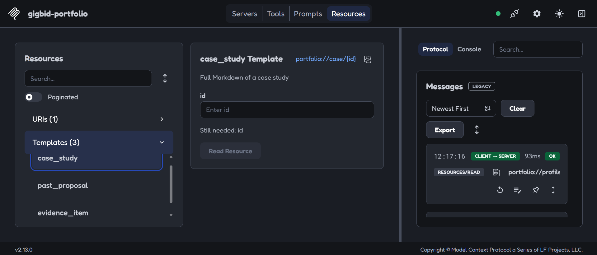
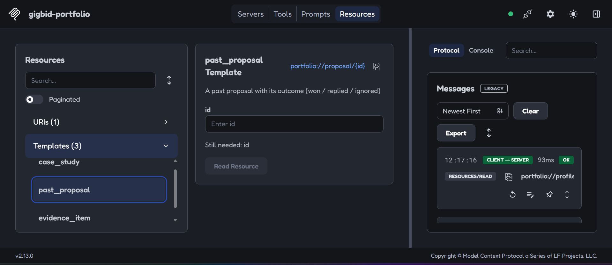
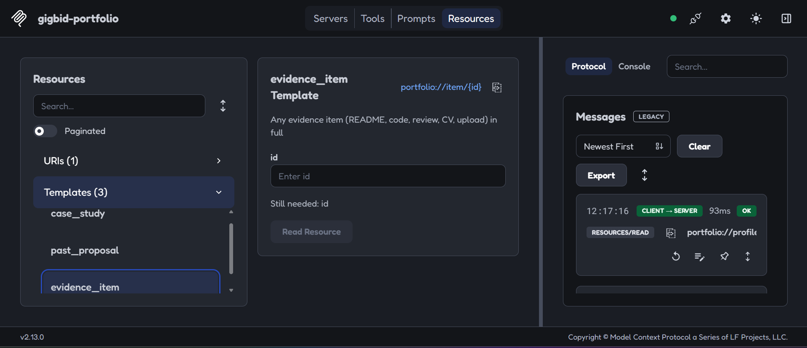
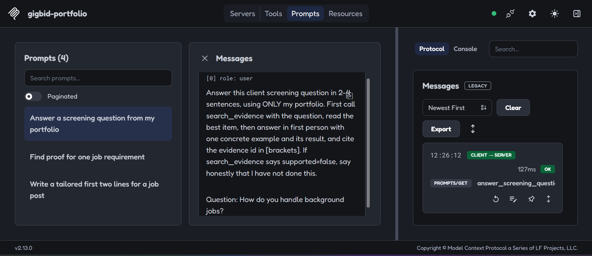
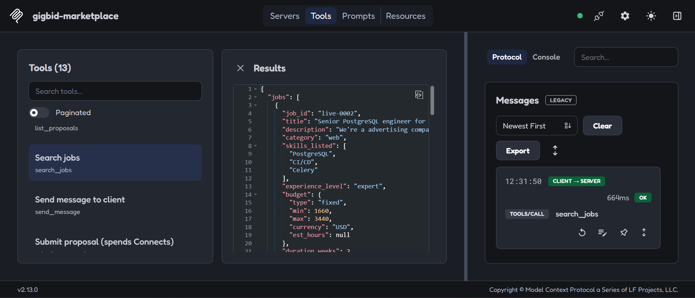
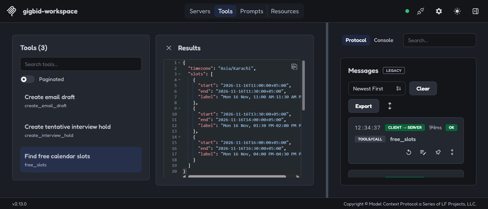

# MCP Inspector evidence

All three GigBid MCP servers, connected over **stdio** in the official MCP Inspector (v2.13.0) on 2026-11-15, using the
importable config [`docs/inspector/gigbid_servers.json`](inspector/gigbid_servers.json) (each server starts through
`tools/mcp_stdio.cmd`). Every call below returned **OK**. The full tool inventory with annotations is in [TOOLS.md](TOOLS.md).

## Portfolio server (read-only): 4 tools, 1 resource, 3 resource templates, 4 prompts

`search_evidence` for "Celery background jobs": the shipped retrieval variant (`v8_corrective`) returns cited evidence
items (id, source file, date, project, client industry, skills, score).



Resource `portfolio://profile` (the persona's evidence index) and the three resource templates:






Prompt `answer_screening_question`: tells the host to call `search_evidence` first, cite evidence ids, and say honestly
when something is not supported.



## Marketplace server: 13 tools (10 read, 3 write with idempotency key + dry_run)

`search_jobs` (category `web`, limit 3) against GigSim:



## Workspace server: 3 tools

`free_slots` with defaults: three 30-minute interview slots in working hours, Asia/Karachi time zone.



## Reproduce

```bash
npx @modelcontextprotocol/inspector
```
Then **Add Servers → Import from client config → From file…** → `docs/inspector/gigbid_servers.json`, and switch a server
on. The portfolio server loads its models before it starts serving (10–60 s), so the first tool call is fast and cannot
hang on Windows.
