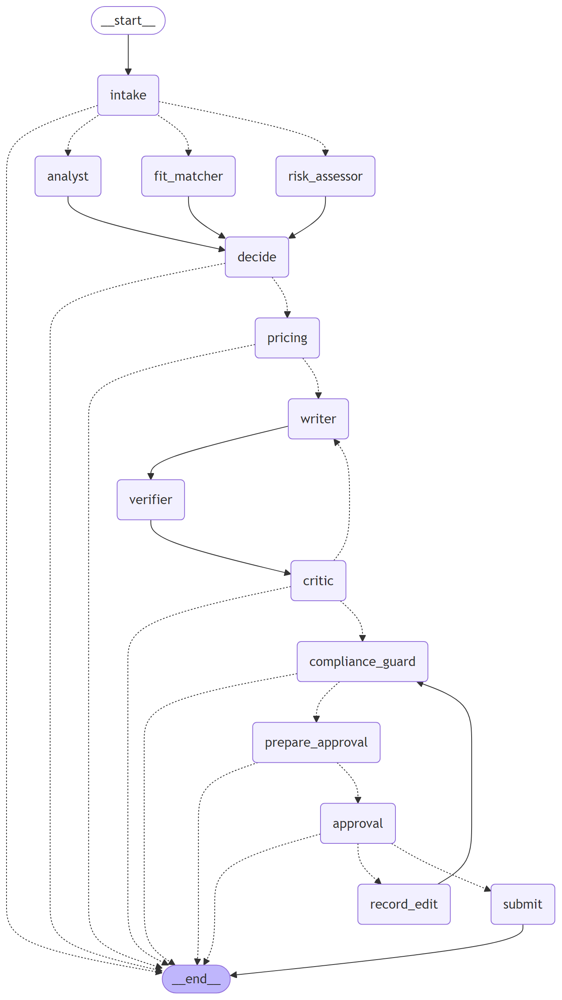

# GigBid — R&D report (engineering design review)

Abdul Ghufran (i230576) · AI-4016 · Repository: github.com/Abdul-Ghufran/gigbid · Every number below is produced
by a script in <code>evals/runners/</code> and stored in <code>evals/results/</code>; tables are regenerated by
<code>python tools/build_report.py</code>. Commit history and traces are linked from the README.

## 1. Problem and constraints

A freelancer spends hours scanning feeds, pays Connects to bid on jobs they cannot win, sends generic proposals and
meets scams that ask for free work or off-platform payment. GigBid automates **discovery, assessment and drafting** and
leaves **every decision** to the freelancer.

**Never automated (enforced in code, not prompts):** sending a proposal or message, spending Connects, accepting
terms, or claiming experience the portfolio cannot prove. Proposals and messages pass a LangGraph `interrupt()` and are
submitted only after approval in the UI; in live Upwork mode even an approved proposal is created as a draft the user
confirms on Upwork. A per-user autonomy setting can auto-*skip* low-fit jobs but never auto-send.

**Budgets (declared in `agent/config.yaml`):** p95 ≤ 25 s per job analysed and ≤ 90 s per proposal; ≤ $0.002 per job
analysed and ≤ $0.01 per proposal at Groq list prices (the free tier bills $0). **Hard constraints that shaped the
design:** open models only for the deployed link (Groq free tier: per model 8K tokens/min and **200K tokens/day**; Qwen
additionally 1K output tokens/min), and a 512 MB / 0.1 CPU free Render instance.

**Evaluation world.** The starter kit shipped without GigSim, the persona corpora and the dev set. I built a documented
stand-in (`docs/DATA_CARD.md`): 3 personas (599 evidence items, 450 past proposals with outcomes), 520 clients with hidden
preferences, 1,500 historical and 360 live jobs, and 600 gold-labelled dev jobs. It was frozen before tuning
(`gigsim/MANIFEST.sha256`, checked in CI). The main threat to validity is that one author wrote the world and the
system; hard paraphrases unknown to GigBid's skill normaliser and code-only skills reduce, but do not remove, it.

## 2. Architecture

**Bid graph (one thread per job, rendered from code, right).** `intake` → `Send` to Job Analyst ∥ Risk Assessor ∥ Fit
Matcher (reducers merge their outputs) → rule-based `decide` (skip / watch / bid) → Pricing → Writer → claim verifier →
Critic (≤ 2 revisions) → Compliance Guard → dry-run previews → `interrupt()` → submit | edit (diffed, saved for style
memory, re-checked by Compliance) | reject with reason. **Conversation graph** (one thread per client conversation):
read → classify intent → calendar slots / walk-away counter-offer → draft → dry run → `interrupt()` → send + tentative
holds.

**State vs trace vs memory.** State is a typed `BidState` (job, analyses, evidence, decision, price, draft, verification,
critiques, compliance, approvals, submission, budgets). The execution trace — every node, tool name, arguments, result,
tokens, cost — goes to `RunEvent` rows (live SSE run viewer), the MCP append-only audit log and Langfuse, under one trace
id from the UI request to the audit row; PII is masked first. Long-term memory lives in a LangGraph store and is written
only by `promotion_rules.py`: a style rule needs the same edit pattern in ≥ 3 edits across ≥ 3 jobs within 30 days; an
outcome lesson needs ≥ 5 outcomes in a category and a ≥ 10-point reply-rate lift. Raw edits are stored separately and the
user can view and delete promoted items.

**Marketplace port and MCP surface.** Agents never call GigSim, Upwork, files or the database directly. Three servers of
our own — Portfolio (read-only RAG), Marketplace (reads; `create_proposal_draft`, `submit_proposal`, `send_message` with
Pydantic constraints, output schemas, `destructiveHint` annotations, mandatory idempotency keys, `dry_run`, bearer auth,
per-user token bucket, append-only audit log) and Workspace (free slots, tentative holds, email drafts) — plus Upwork's
official server (through `MultiServerMCPClient`, OAuth 2.1 with PKCE and dynamic registration, tokens Fernet-encrypted per
user) and GitHub's (repo ingestion). The Marketplace server selects the GigSim or Upwork adapter by config, so the graph
cannot tell which marketplace it uses. Each agent sees an allowlisted subset of tools; calls have timeouts, bounded
retries and a `MarketplaceDown` degraded mode (UI banner, work queued and retried). **Stores:** Postgres (app data,
checkpoints, LangGraph store, audit log, idempotency, GigSim state), on-disk embedding cache, Redis/Arq in compose.

**Why each agent exists:** see `docs/ARCHITECTURE.md` (rule-first Risk Assessor keeps scams away from the expensive writer;
the Fit Matcher's *unsupported* list is the writer's contract; the verifier is independent of the writer; the Critic's
deterministic pre-checks spend no tokens on obvious failures). Durability: Postgres checkpointer; a proposal paused at
approval survives an API restart and is submitted exactly once (integration test
`test_crash_while_waiting_then_resume_submits_exactly_once`; content-derived idempotency keys at two layers).

## 3. R&D question A — does tool granularity change agent behaviour?

**Hypothesis.** A few coarse tools save prompt tokens but cost tool-selection and argument accuracy; GigBid's tools with
rewritten, constraint-rich descriptions are most accurate at a higher token cost. **Setup.** 40 tasks with known correct
calls (10 intents × 4 instances), one forced tool call per task with gpt-oss-20b, three tool sets
(`evals/runners/rq_a_tools.py`).

| Tool set | Tools | Tool-selection accuracy | Argument accuracy | Tokens / task |
|---|---|---|---|---|
| fine | 22 | 0.975 | 0.950 | 667 |
| coarse | 2 | 0.725 | 0.575 | 285 |
| best | 12 | 1 | 1 | 1132 |

**Result.** Collapsing tools into `marketplace(action, params)` dropped tool selection to 72.5% and argument
accuracy to 57.5%: the model invents action names and misplaces arguments in a free-form `params` object.
22 narrow tools reached 97.5% / 95.0%. GigBid's 12 tools reached 100.0% / 100.0% at
1132 tokens per task versus 667. **Conclusion:** granularity matters less than schema quality —
explicit enums, required fields and descriptions that say *when* to use a tool (e.g. "dry_run=True previews cost") buy
accuracy; the extra ~460 tokens per call are worth it for write tools, and the R&D C results show why reliable tool
calls matter.

## 4. R&D question B — retrieval, verification and what ships

**Hypothesis (stated before running).** "Requirement decomposition plus hybrid retrieval raises evidence Recall@5 by
15 points over V0 on jobs with four or more requirements." **Result: rejected for hybrid** — decomposed hybrid + rerank
reached 0.725 vs V0 0.687 (+3.8 pts) — **but exceeded by the skill graph** (0.899).
Ten variants were implemented as configurable components (`rag/variants/`), evaluated on 444 scoreable dev jobs.

| Variant | Recall@5 | MRR | nDCG@10 | Recall@5 (>= 4 requirements) | p95 latency (s) |
|---|---|---|---|---|---|
| v0_naive | 0.740 | 0.848 | 0.579 | 0.687 | 0.086 |
| v1_decompose | 0.762 | 0.724 | 0.476 | 0.724 | 0.054 |
| v2_hybrid | 0.750 | 0.766 | 0.577 | 0.703 | 0.005 |
| v3_rerank | 0.769 | 0.797 | 0.533 | 0.725 | 5.910 |
| v4_outcome | 0.642 | 0.761 | 0.477 | 0.602 | 7.474 |
| v5_multivector | 0.773 | 0.837 | 0.552 | 0.764 | 0.008 |
| v6_contextual | 0.838 | 0.860 | 0.581 | 0.812 | 0.012 |
| v8_corrective over v3 rerank (first run, uncalibrated grader threshold 0) | 0.682 | 0.747 | 0.543 | 0.673 | 15.802 |
| v9_skill_graph | 0.911 | 0.875 | 0.604 | 0.899 | 0.003 |
| **v8_corrective over v9 (shipped)** | 0.890 | 0.951 | 0.655 | 0.892 | 0.074 |

V6 uses deterministic context headers (LLM context lines did not fit the free-tier token budget); V7 HyDE was not run on the full set for the same reason.

| Configuration | Recall@5 | MRR | nDCG@10 |
|---|---|---|---|
| full: corrective loop + skill graph | 0.890 | 0.951 | 0.655 |
| - corrective loop (plain V9) | 0.895 | 0.873 | 0.583 |
| - skill graph (dense per requirement) | 0.762 | 0.724 | 0.476 |
| - requirement decomposition | 0.679 | 0.943 | 0.656 |
| - dense fallback for unrecognised skills | 0.911 | 0.875 | 0.604 |
| - industry / outcome boosts | 0.906 | 0.880 | 0.591 |

### By persona (shipped pipeline)

| Persona | Recall@5 | MRR | nDCG@10 |
|---|---|---|---|
| ai | 0.887 | 0.958 | 0.632 |
| web | 0.925 | 0.983 | 0.682 |
| data | 0.858 | 0.912 | 0.652 |

### By job type (shipped pipeline)

| Job type | n | Recall@5 | nDCG@10 |
|---|---|---|---|
| strong | 186 | 0.912 | 0.662 |
| vague | 42 | 0.696 | 0.565 |
| partial | 120 | 0.915 | 0.682 |
| low_budget | 42 | 0.892 | 0.678 |
| injection | 54 | 0.908 | 0.629 |

Two negative results: cross-encoder reranking (V3) bought 0.769 vs 0.740 Recall@5 at a p95 of 5.91 s, and
outcome-aware boosting (V4) *hurt* (0.642): projects that won before are not the relevant ones for a new job. Context
headers (V6, deterministic, 0.838) helped more than reranking. LLM-generated context lines (V6) and HyDE (V7) were not
run on the full set: at ~600 items and 444 jobs they did not fit the 200K-tokens/day budget.

**Claim verification (B3).** Claims are split and checked against cited evidence (semantic similarity + every number
and every named tool must appear in the evidence); unsupported claims are rewritten by the model and re-verified, or
removed, before the Critic sees the draft. On 302 labelled claims the first rule scored F1 0.689 — it
called fabricated numbers "partly supported" (0 % caught) — and the shipped rule 0.990; the bi-encoder matched the
cross-encoder, so the reranker left the 512 MB deployment (ADR-005).

**Retrieval → outcomes.** Same 90 gold-bid jobs, same deterministic writer, only retrieval differs
(`retrieval_outcome_test.json`): unsupported claims 1.48 → **0.34** per proposal (Wilcoxon p < 0.001),
simulated client score 1.09 → **1.25** (paired t, p = 0.0000), interviews 21.1% → 33.3%
(McNemar p = 0.08), reply rate 72.2% → 64.4% (p = 0.26, not significant).

**Where better retrieval did not raise the reply rate, and why.** With the first writer, the shipped retriever *lowered*
replies (37.8% → 15.6%). The client features explain it (`reply_gap_analysis.json`): V0's weaker
evidence made the writer restate the client's requirement, which names their must-have skills (coverage 0.47
vs 0.20), and GigSim's client rewards keyword coverage but cannot check truth. The fix — name the requirement
next to the proof that covers it, only for supported requirements — is honest and raised the shipped pipeline's reply
rate to 64.4%.

| Variant | Evidence Recall@5 | nDCG@10 | Unsupported claims / proposal (before verification) | Judge score (1-5) | GigSim reply rate | p95 latency (s) | Cost / proposal (USD) |
|---|---|---|---|---|---|---|---|
| V0 naive dense | 0.740 | 0.579 | 1.48 | 3.03 | 72.2% | 7.5 | pending |
| Shipped: V8 corrective over V9 skill graph | 0.890 | 0.655 | 0.34 | 3.33 | 64.4% | 3481.5 | 0.0025 |

Retrieval metrics: `rag_variants_offline.json` (444 scoreable dev jobs), `rag_ablation.json`. Proposal metrics: `proposals_*_fixedwriter_v2.json` (90 gold-bid jobs, same deterministic writer, so only retrieval differs). Judge: `judge_scores.json`. Latency / cost of the live-model pipeline: `proposals_best_live.json`.

**Decision on what ships.** The corrective loop over the skill graph (V8 on V9, grader cosine 0.83 calibrated to F1
0.985) with bi-encoder verification: best Recall@5/MRR/nDCG, 4× fewer unsupported claims than V0, no reranker in memory,
p95 retrieval < 0.1 s, and an explicit "cannot prove this" signal that the writer and the skip decision use. By persona
and job type: appendix A.

## 5. R&D question C — single agent vs prebuilt supervisor vs our graph

**Setup.** Dev jobs stratified over strong, partial, off-domain, scam, injection and low-budget posts (n = 6,
the same jobs for every architecture); the same
model (openai/gpt-oss-120b) for every architecture: (a) one `create_react_agent` with all marketplace + portfolio tools,
(b) `langgraph-supervisor` over a marketplace researcher and a portfolio researcher, (c) GigBid's graph. Shipped letters
are audited by the same verifier and policy checks (`rq_c_architectures.py`).

_6 dev jobs, model `openai/gpt-oss-120b` for every architecture. n/a = no bid letters to audit._

| Architecture | Bid/skip accuracy | Scams skipped | Unsupported claims / letter | Letters with violations shipped | GigSim reply rate | Rejected tool calls | Mean tokens / job | p95 latency (s) |
|---|---|---|---|---|---|---|---|---|
| react | 0.833 | 1/1 | 0 | 0 | 100.0% | 8 | 7277 | 7411.7 |
| supervisor | 0.667 | 1/1 | 1.25 | 0 | 50.0% | 3 | 10346 | 8686.2 |
| graph | 1 | 1/1 | 0 | 0 | 50.0% | 0 | 6379 | 645.3 |

**Reading.** Bid/skip accuracy: ReAct 0.833, supervisor 0.667, graph 1 (best:
graph). Mean tokens per job: ReAct 7277, supervisor 10346, graph 6379 (fewest:
graph); fastest p95: graph; fewest unsupported claims per letter: tie (react, graph).
Letters shipped with a policy violation: ReAct 0, graph 0. Rejected (malformed) tool calls:
ReAct 8, supervisor 3; the graph calls tools deterministically, so it has none by construction.
In an earlier attempt on Qwen3.8-27B the tool-calling baselines failed outright — the model invented tool names
(`search_eidence`) that Groq rejected — which is why the comparison was re-run on gpt-oss-120b for all three architectures.
The graph's structural guarantees hold regardless of the scores: the verifier and the Compliance Guard run on every letter
whatever the model decided, and its rule-based risk gate is not steerable by injected text. Where a baseline is cheaper or
faster (see the per-kind accuracy in `rq_c_architectures.json`), it is a candidate first-pass triage filter; I would not
ship it to write proposals without the verifier and compliance stages. Sample size is small (jobs completed by every
architecture: 6) because of the free-tier cap of 200,000 tokens per model per day: a single ReAct or supervisor
run spends roughly 1,000–16,000 tokens and, once the cap is reached, waits on it for over an hour, so differences of one or two jobs are not meaningful.
Tokens per job are the robust cost signal; latency is not, because runs made while the daily quota was exhausted include
quota waits of up to two hours (the same jobs took 5–60 s once quota was available).

## 6. The change request (2 Nov 2026)

GigSim's policy update made jobs with ≥ 20 proposals cost 1.5× Connects and rejects proposals with unanswered screening
questions. Because platform rules live in `agent/config.yaml` (`platform_policy`) and the policy pack, absorbing it was
**one commit: `agent/config.yaml` +4/−4 and the policy pack +2 lines, no Python changed, ~15 minutes** including the
evaluation. Against GigSim running the new policy (`change_request_eval.json`): Connects mispredicted on
33.7% of gold-bid jobs before → 0.0% after; proposals with a blank answer went from
177 rejected by the marketplace at submission to 177 caught by the Compliance Guard before
any Connects were spent. The design lesson: the agent code had no idea a "policy" existed — pricing reads a multiplier and
compliance reads a flag.

## 7. Signature extension — X2 proposal experiments

Two strategies (`proof_first`, `plan_first`) live in config; each job is assigned by a stable hash; Analytics shows
reply rate per arm from real marketplace events. Offline, a **paired** design re-arranged the same sentences in both
structures for 88 jobs: 19.3% vs 21.6%, McNemar exact p = 0.82. The simulated client's score was
identical for every pair — GigSim's rule-based client is blind to paragraph order — so the experiment correctly refuses
to declare a winner, and the real finding is about measurement validity (`docs/EXTENSION.md`).

## 8. Failure analysis

Real failed dev jobs pulled from the results files by `evals/runners/failure_analysis.py`:

| # | Job | Failure category | Node | What went wrong | Fixed? |
|---|---|---|---|---|---|
| 1 | `dev-ai-024` | wrong bid (partial fit) | decide (Fit Matcher score) | fit 0.67 >= 0.55 but gold coverage < 0.6 | yes |
| 2 | `dev-ai-039` | wrong bid (partial fit) | decide (Fit Matcher score) | fit 1.00 >= 0.55 but gold coverage < 0.6 | no |
| 3 | `dev-ai-042` | wrong bid (partial fit) | decide (Fit Matcher score) | fit 0.57 >= 0.55 but gold coverage < 0.6 | yes |
| 4 | `dev-web-155` | wrong skip | fit_matcher | gold bid, predicted skip (fit 0.00) | no |
| 5 | `dev-ai-000` | mispriced | pricing | old quote 45.0 outside band [46.8, 63.2]; new quote 57.3 | yes |
| 6 | `dev-ai-001` | mispriced | pricing | old quote 2803.6 outside band [3090.0, 4170.0]; new quote 3893.0 | yes |
| 7 | `dev-web-047` | missed evidence | fit_matcher / retrieval | Recall@5 0.00 (partial, 3 requirements) | no |
| 8 | `dev-ai-066` | missed evidence | fit_matcher / retrieval | Recall@5 0.33 (vague, 3 requirements) | no |
| 9 | `dev-ai-194` | unsupported claim | writer -> verifier | 4 unsupported claims before verification, 0 after | yes |
| 10 | `dev-web-143` | unsupported claim | writer -> verifier | 4 unsupported claims before verification, 0 after | yes |
| 11 | `dev-ai-184` | generic opening / low coverage | writer | proof never named the client's must-have skill; simulated client did not reply | no |
| 12 | `dev-ai-167` | generic opening / low coverage | writer | proof never named the client's must-have skill; simulated client did not reply | no |

| Category | Fix tried | Measured effect |
|---|---|---|
| wrong bid (partial fit) | Raised bid_min_fit 0.55 -> 0.70 (middle of the plateau in threshold_sweep.json) | partial-fit accuracy 61.7% -> 90.0%, bid F1 0.918 -> 0.976 on the same 600 jobs |
| mispriced | Pricing v2: anchor on the job's own budget range instead of the category median | price inside fair band 52.8% -> 86.2% (pricing_eval.json, 282 jobs); remaining misses are hourly jobs where the client range sits below market |
| missed evidence | Skill graph (V9) + requirement decomposition; corrective grader marks the requirement unsupported instead of guessing | Recall@5 0.740 -> 0.890; residual misses are hard paraphrases with no skill keyword (e.g. 'a document store') |
| unsupported claim | Strict number/tool rule + rewrite-then-reverify; fallback writer v3 opening without an uncited claim | unsupported claims per proposal 1.13 -> 0.34 before verification, 0 after (retrieval_outcome_test.json) |
| generic opening / low coverage | Name the client's requirement next to the proof that covers it (writer prompt v2.5 + fallback writer) | simulated reply rate 15.6% -> 64.4% for the shipped pipeline on the same 90 jobs |
| wrong skip | None yet: these are gold-bid jobs whose requirement sentences contain only hard paraphrases, so the Fit Matcher finds no skill and the dense fallback stays under the 0.83 cosine grader | not fixed - candidate fix: LLM requirement rewrite in the corrective loop (llm_rewrite option), not enabled because of the free-tier token budget |

Development failures that the evaluation exposed (each fixed and re-measured): a requirement splitter that cut "Next.js"
at the dot (0/5 evidence on a strong-fit job); the verifier emptying screening answers so the Critic burned both revisions;
the deterministic writer's uncited opening line deleted by the verifier on every letter; Qwen's 1K output-tokens/minute cap
truncating its JSON answers.

## 9. Safety and platform respect

**Must never happen:** sending without approval, spending Connects twice, off-platform contact or payment, invented
experience, following instructions inside job posts or client messages, scraping or browser automation, leaking tokens or
PII. **Enforcement:** `interrupt()` + idempotency keys at two layers; Marketplace write tools default to `dry_run=True`;
live mode creates drafts only and polls no more than every 3 h; rule-first risk gate (scam precision 1.000, recall
1.000 on 600 dev jobs; injection posts detected 100.0%); injected spans stripped and the rest delimited as
untrusted data; output-side Compliance Guard; PII masked in logs, traces and the audit log; OAuth tokens Fernet-encrypted;
every query scoped by user id. **Measured attack success** on 18 planted-injection jobs: undefended 22.2%,
defended model output 0.0%, defended and shipped 0.0%; detector false-positive rate on clean posts
0.0%. **What still gets through:** paraphrased injections without trigger phrases are only caught by their effects
(contact details, guarantees, inflated experience); an attacker who asks for something policy-compliant but harmful (e.g.
"mention you can start tomorrow") is not detected; and the verifier checks numbers and tools, not adjectives like
"extensive".

## 10. Hidden test run against declared budgets

The hidden run happens after submission on the deployed open profile; until then, the measured values on the dev set are:

| Budget | Declared | Measured | Source |
|---|---|---|---|
| p95 latency per job analysed | 25 s | 4.5 s (offline-rules path, CPU) | `decision_eval_offline.json` |
| p95 latency per proposal (live models) | 90 s | 3481.5 s (p50 2590.6 s, n = 3) | `proposals_best_live.json` |
| cost per proposal (list price) | $0.01 | $0.0025 (10057 tokens) | `proposals_best_live.json` |
| unsupported claims per proposal (live) | — | 0 before → 0 after verification | `proposals_best_live.json` |

**Optimisation that helped:** deterministic pre-checks in the Critic plus trimmed evidence snippets (320 chars) — the first
live proposal used 17.4K tokens across 9 calls with two full revisions; budget enforcement (token budget per thread) and
the quota-aware fallback (a long 429 fails over immediately instead of stalling) keep the system answering when the daily
token cap is hit. **Without excuses:** on a busy day the strong model's 200K-token daily cap allows roughly a dozen
fully revised proposals; beyond that GigBid falls back to the smaller model and then to its deterministic grounded
template — still verified and compliant, but plainer.

## Appendix A — results by persona and job type, decisions, verifier

| Metric | Value |
|---|---|
| bid_f1 | 0.918 |
| bid_precision | 0.852 |
| bid_recall | 0.997 |
| scam_precision | 1.000 |
| scam_recall | 1.000 |
| injection_detected | 1.000 |
| price_in_fair_band | 0.847 |
| bid_f1 at shipped threshold 0.70 (threshold_sweep.json) | 0.976 |
| price in fair band, pricing rule v1 -> v2 (pricing_eval.json, 282 jobs) | 0.528 -> 0.862 |

| Persona | Bid F1 | Scam recall |
|---|---|---|
| ai | 0.922 | 1.000 |
| web | 0.907 | 1.000 |
| data | 0.926 | 1.000 |

| Rule | Mode | F1 (detect fabrication) | Precision | Recall |
|---|---|---|---|---|
| v1 (number/tool mismatch = partly) | cross_encoder | 0.689 | 1.000 | 0.525 |
| v1 (number/tool mismatch = partly) | bi_encoder | 0.597 | 1.000 | 0.425 |
| v2 shipped (mismatch = unsupported) | cross_encoder | 0.990 | 0.985 | 0.995 |
| v2 shipped (mismatch = unsupported) | bi_encoder | 0.990 | 0.985 | 0.995 |

302 labelled claims (invented 51, true 51, true_skill 51, wrong_citation 51, wrong_number 47, wrong_tool 51).

Unsupported claims per proposal before -> after verification:

- `v0_fixedwriter_v3`: 1.48 -> 0 (n=90)
- `best_fixedwriter_v3`: 0.34 -> 0 (n=90)
- `v0_fixedwriter_v2`: 2.24 -> 0 (n=90)
- `best_fixedwriter_v2`: 1.29 -> 0.011 (n=90)
- `v0_fixedwriter`: 2.07 -> 0 (n=90)
- `best_fixedwriter`: 1.13 -> 0.011 (n=90)
- `best_live`: 0 -> 0 (n=3)

| Metric | Value |
|---|---|
| attacks (planted-injection dev jobs) | 18 |
| attack success rate, undefended | 22.2% |
| attack success rate, defended model output | 0.0% |
| attack success rate, defended and shipped (after Compliance Guard) | 0.0% |
| detector recall on planted injections | 100.0% |
| detector false-positive rate on clean posts | 0.0% |

| | Before (old config) | After (config-only change) |
|---|---|---|
| Connects cost mispredicted (282 gold-bid jobs) | 33.7% | 0.0% |
| Blank-answer proposals caught before submit / rejected by marketplace | 0 / 177 | 177 / 0 |

git show <change-request commit>: agent/config.yaml +4/-4, data/policy_pack/marketplace_policy.md +2; no Python changed

| Arm | Reply rate | Mean client score |
|---|---|---|
| proof_first | 19.3% | 0.403 |
| plan_first | 21.6% | 0.403 |

88 pairs; discordant {'only_plan_first_replied': 11, 'only_proof_first_replied': 9}; McNemar exact p = 0.8238.

| Proposal set | must-have coverage | personalisation | specific result | unsupported before | reply rate |
|---|---|---|---|---|---|
| v0_fixedwriter | 0.467 | 0.354 | 0.411 | 2.07 | 37.8% |
| best_fixedwriter | 0.200 | 0.194 | 0.744 | 1.13 | 15.6% |
| best_fixedwriter_v2 (fix: name the requirement next to its proof) | - | - | - | 1.29 | 48.9% |

## Appendix B — judge calibration

The LLM judge (`agent/prompts/judge.md`, 1–5 rubric) is calibrated against my own labels on 30 anonymised proposals
(`evals/datasets/judge_calibration_sheet.csv`): Cohen's κ = pending, quadratic-weighted κ = pending (n = pending;
`judge_calibration.json`, with the largest disagreements listed for the viva). A blind pairwise human panel
(`human_panel_pairs.csv`, 15 pairs, V0 vs shipped, sides randomised; key in `human_panel_key.json`): pending
classmates cast pending votes; the shipped pipeline's proposal was preferred in pending (binomial p = pending;
`human_panel.json`).

## Appendix C — reproducibility

`make eval` reruns every evaluation; `python tools/build_report.py && node apps/web/scripts/render_pdf.mjs` rebuilds this
report. Pinned versions are in `pyproject.toml` and `apps/web/package.json`. AI assistance and the mistakes it made that I
caught are listed in `docs/AI_USAGE.md`.
