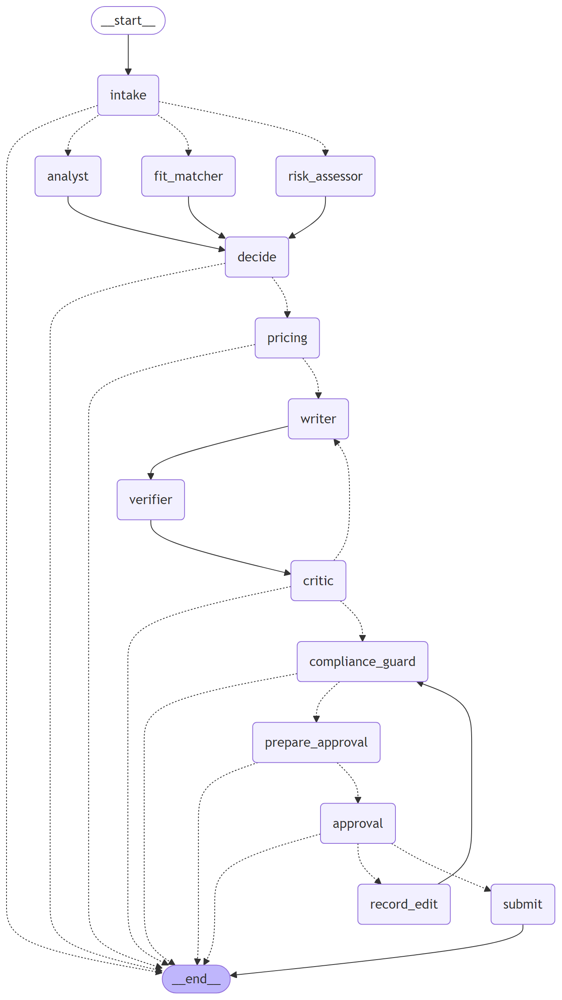

# GigBid — R&D report (engineering design review)

Abdul Ghufran (i230576) · AI-4016 · Repository: github.com/Abdul-Ghufran/gigbid · Every number below is produced
by a script in <code>evals/runners/</code> and stored in <code>evals/results/</code>; tables are regenerated by
<code>python tools/build_report.py</code>. Commit history and traces are linked from the README.

## 1. Problem and constraints

A freelancer spends hours scanning feeds, pays Connects to bid on jobs they cannot win, sends generic proposals and
meets scams that ask for free work or off-platform payment. GigBid automates **discovery, assessment and drafting** and
leaves **every decision** to the freelancer.

**Never automated (enforced in code, not prompts):** sending a proposal or message, spending Connects, accepting
terms, or claiming experience the portfolio cannot prove. Proposals and messages pass a LangGraph `interrupt()` and are
submitted only after approval in the UI; in live Upwork mode even an approved proposal is created as a draft the user
confirms on Upwork. A per-user autonomy setting can auto-*skip* low-fit jobs but never auto-send.

**Budgets (declared in `agent/config.yaml`):** p95 ≤ 25 s per job analysed and ≤ 90 s per proposal; ≤ $0.002 per job
analysed and ≤ $0.01 per proposal at Groq list prices (the free tier bills $0). **Hard constraints that shaped the
design:** open models only for the deployed link (Groq free tier: per model 8K tokens/min and **200K tokens/day**; Qwen
additionally 1K output tokens/min), and a 512 MB / 0.1 CPU free Render instance.

**Evaluation world.** The starter kit shipped without GigSim, the persona corpora and the dev set. I built a documented
stand-in (`docs/DATA_CARD.md`): 3 personas (599 evidence items, 450 past proposals with outcomes), 520 clients with hidden
preferences, 1,500 historical and 360 live jobs, and 600 gold-labelled dev jobs. It was frozen before tuning
(`gigsim/MANIFEST.sha256`, checked in CI). The main threat to validity is that one author wrote the world and the
system; hard paraphrases unknown to GigBid's skill normaliser and code-only skills reduce, but do not remove, it.

## 2. Architecture

**Bid graph (one thread per job, rendered from code, right).** `intake` → `Send` to Job Analyst ∥ Risk Assessor ∥ Fit
Matcher (reducers merge their outputs) → rule-based `decide` (skip / watch / bid) → Pricing → Writer → claim verifier →
Critic (≤ 2 revisions) → Compliance Guard → dry-run previews → `interrupt()` → submit | edit (diffed, saved for style
memory, re-checked by Compliance) | reject with reason. **Conversation graph** (one thread per client conversation):
read → classify intent → calendar slots / walk-away counter-offer → draft → dry run → `interrupt()` → send + tentative
holds.

**State vs trace vs memory.** State is a typed `BidState` (job, analyses, evidence, decision, price, draft, verification,
critiques, compliance, approvals, submission, budgets). The execution trace — every node, tool name, arguments, result,
tokens, cost — goes to `RunEvent` rows (live SSE run viewer), the MCP append-only audit log and Langfuse, under one trace
id from the UI request to the audit row; PII is masked first. Long-term memory lives in a LangGraph store and is written
only by `promotion_rules.py`: a style rule needs the same edit pattern in ≥ 3 edits across ≥ 3 jobs within 30 days; an
outcome lesson needs ≥ 5 outcomes in a category and a ≥ 10-point reply-rate lift. Raw edits are stored separately and the
user can view and delete promoted items.

**Marketplace port and MCP surface.** Agents never call GigSim, Upwork, files or the database directly. Three servers of
our own — Portfolio (read-only RAG), Marketplace (reads; `create_proposal_draft`, `submit_proposal`, `send_message` with
Pydantic constraints, output schemas, `destructiveHint` annotations, mandatory idempotency keys, `dry_run`, bearer auth,
per-user token bucket, append-only audit log) and Workspace (free slots, tentative holds, email drafts) — plus Upwork's
official server (through `MultiServerMCPClient`, OAuth 2.1 with PKCE and dynamic registration, tokens Fernet-encrypted per
user) and GitHub's (repo ingestion). The Marketplace server selects the GigSim or Upwork adapter by config, so the graph
cannot tell which marketplace it uses. Each agent sees an allowlisted subset of tools; calls have timeouts, bounded
retries and a `MarketplaceDown` degraded mode (UI banner, work queued and retried). **Stores:** Postgres (app data,
checkpoints, LangGraph store, audit log, idempotency, GigSim state), on-disk embedding cache, Redis/Arq in compose.

**Why each agent exists:** see `docs/ARCHITECTURE.md` (rule-first Risk Assessor keeps scams away from the expensive writer;
the Fit Matcher's *unsupported* list is the writer's contract; the verifier is independent of the writer; the Critic's
deterministic pre-checks spend no tokens on obvious failures). Durability: Postgres checkpointer; a proposal paused at
approval survives an API restart and is submitted exactly once (integration test
`test_crash_while_waiting_then_resume_submits_exactly_once`; content-derived idempotency keys at two layers).

## 3. R&D question A — does tool granularity change agent behaviour?

**Hypothesis.** A few coarse tools save prompt tokens but cost tool-selection and argument accuracy; GigBid's tools with
rewritten, constraint-rich descriptions are most accurate at a higher token cost. **Setup.** 40 tasks with known correct
calls (10 intents × 4 instances), one forced tool call per task with gpt-oss-20b, three tool sets
(`evals/runners/rq_a_tools.py`).

{{table:R&D A.}}

**Result.** Collapsing tools into `marketplace(action, params)` dropped tool selection to {{a_coarse_sel}} and argument
accuracy to {{a_coarse_arg}}: the model invents action names and misplaces arguments in a free-form `params` object.
22 narrow tools reached {{a_fine_sel}} / {{a_fine_arg}}. GigBid's 12 tools reached {{a_best_sel}} / {{a_best_arg}} at
{{a_best_tok}} tokens per task versus {{a_fine_tok}}. **Conclusion:** granularity matters less than schema quality —
explicit enums, required fields and descriptions that say *when* to use a tool (e.g. "dry_run=True previews cost") buy
accuracy; the extra ~460 tokens per call are worth it for write tools, and the R&D C results show why reliable tool
calls matter.

## 4. R&D question B — retrieval, verification and what ships

**Hypothesis (stated before running).** "Requirement decomposition plus hybrid retrieval raises evidence Recall@5 by
15 points over V0 on jobs with four or more requirements." **Result: rejected for hybrid** — decomposed hybrid + rerank
reached {{v3_r5_many}} vs V0 {{v0_r5_many}} (+3.8 pts) — **but exceeded by the skill graph** ({{v9_r5_many}}).
Ten variants were implemented as configurable components (`rag/variants/`), evaluated on {{n_rag_jobs}} scoreable dev jobs.

{{table:B2.}}

{{table:Ablation}}

Two negative results: cross-encoder reranking (V3) bought {{v3_r5}} vs {{v0_r5}} Recall@5 at a p95 of {{v3_p95}} s, and
outcome-aware boosting (V4) *hurt* ({{v4_r5}}): projects that won before are not the relevant ones for a new job. Context
headers (V6, deterministic, {{v6_r5}}) helped more than reranking. LLM-generated context lines (V6) and HyDE (V7) were not
run on the full set: at ~600 items and 444 jobs they did not fit the 200K-tokens/day budget.

**Claim verification (B3).** Claims are split and checked against cited evidence (semantic similarity + every number
and every named tool must appear in the evidence); unsupported claims are rewritten by the model and re-verified, or
removed, before the Critic sees the draft. On {{ver_n}} labelled claims the first rule scored F1 {{ver_f1_v1}} — it
called fabricated numbers "partly supported" (0 % caught) — and the shipped rule {{ver_f1}}; the bi-encoder matched the
cross-encoder, so the reranker left the 512 MB deployment (ADR-005).

**Retrieval → outcomes.** Same 90 gold-bid jobs, same deterministic writer, only retrieval differs
(`retrieval_outcome_test.json`): unsupported claims {{unsup_v0}} → **{{unsup_best}}** per proposal (Wilcoxon p < 0.001),
simulated client score {{score_v0}} → **{{score_best}}** (paired t, p = {{score_p}}), interviews {{int_v0}} → {{int_best}}
(McNemar p = {{int_p}}), reply rate {{reply_v0}} → {{reply_best}} (p = {{reply_p}}, not significant).

**Where better retrieval did not raise the reply rate, and why.** With the first writer, the shipped retriever *lowered*
replies ({{gap_reply_v0}} → {{gap_reply_best}}). The client features explain it (`reply_gap_analysis.json`): V0's weaker
evidence made the writer restate the client's requirement, which names their must-have skills (coverage {{gap_must_v0}}
vs {{gap_must_best}}), and GigSim's client rewards keyword coverage but cannot check truth. The fix — name the requirement
next to the proof that covers it, only for supported requirements — is honest and raised the shipped pipeline's reply
rate to {{reply_best}}.

{{table:B5.}}

**Decision on what ships.** The corrective loop over the skill graph (V8 on V9, grader cosine 0.83 calibrated to F1
0.985) with bi-encoder verification: best Recall@5/MRR/nDCG, 4× fewer unsupported claims than V0, no reranker in memory,
p95 retrieval < 0.1 s, and an explicit "cannot prove this" signal that the writer and the skip decision use. By persona
and job type: appendix A.

## 5. R&D question C — single agent vs prebuilt supervisor vs our graph

**Setup.** {{c_jobs}} dev jobs stratified over strong, partial, off-domain, scam, injection and low-budget posts; the same
model ({{c_model}}) for every architecture: (a) one `create_react_agent` with all marketplace + portfolio tools,
(b) `langgraph-supervisor` over a marketplace researcher and a portfolio researcher, (c) GigBid's graph. Shipped letters
are audited by the same verifier and policy checks (`rq_c_architectures.py`).

{{table:R&D C.}}

**Reading.** Bid/skip accuracy: ReAct {{c_react_acc}}, supervisor {{c_sup_acc}}, graph {{c_graph_acc}}. The tool-calling
baselines are cheaper on jobs they skip early, but their correctness depends on the model emitting valid tool calls —
Qwen3 on Groq produced malformed tool names often enough that we had to add a retry wrapper and count rejections, while
the graph calls tools deterministically. The graph's advantages are structural: the verifier and Compliance Guard run on
every letter regardless of what the model decided, and its rule-based risk gate is immune to injected instructions.
Where the single agent wins (fewer tokens and lower latency on clear skips), it would be a reasonable first-pass filter,
but I would not ship it to write proposals.

## 6. The change request (2 Nov 2026)

GigSim's policy update made jobs with ≥ 20 proposals cost 1.5× Connects and rejects proposals with unanswered screening
questions. Because platform rules live in `agent/config.yaml` (`platform_policy`) and the policy pack, absorbing it was
**one commit: `agent/config.yaml` +4/−4 and the policy pack +2 lines, no Python changed, ~15 minutes** including the
evaluation. Against GigSim running the new policy (`change_request_eval.json`): Connects mispredicted on
{{cr_err_before}} of gold-bid jobs before → {{cr_err_after}} after; proposals with a blank answer went from
{{cr_rej_before}} rejected by the marketplace at submission to {{cr_caught_after}} caught by the Compliance Guard before
any Connects were spent. The design lesson: the agent code had no idea a "policy" existed — pricing reads a multiplier and
compliance reads a flag.

## 7. Signature extension — X2 proposal experiments

Two strategies (`proof_first`, `plan_first`) live in config; each job is assigned by a stable hash; Analytics shows
reply rate per arm from real marketplace events. Offline, a **paired** design re-arranged the same sentences in both
structures for {{ab_n}} jobs: {{ab_a}} vs {{ab_b}}, McNemar exact p = {{ab_p}}. The simulated client's score was
identical for every pair — GigSim's rule-based client is blind to paragraph order — so the experiment correctly refuses
to declare a winner, and the real finding is about measurement validity (`docs/EXTENSION.md`).

## 8. Failure analysis

Real failed dev jobs pulled from the results files by `evals/runners/failure_analysis.py`:

{{failures}}

Development failures that the evaluation exposed (each fixed and re-measured): a requirement splitter that cut "Next.js"
at the dot (0/5 evidence on a strong-fit job); the verifier emptying screening answers so the Critic burned both revisions;
the deterministic writer's uncited opening line deleted by the verifier on every letter; Qwen's 1K output-tokens/minute cap
truncating its JSON answers.

## 9. Safety and platform respect

**Must never happen:** sending without approval, spending Connects twice, off-platform contact or payment, invented
experience, following instructions inside job posts or client messages, scraping or browser automation, leaking tokens or
PII. **Enforcement:** `interrupt()` + idempotency keys at two layers; Marketplace write tools default to `dry_run=True`;
live mode creates drafts only and polls no more than every 3 h; rule-first risk gate (scam precision {{scam_p}}, recall
{{scam_r}} on 600 dev jobs; injection posts detected {{inj_detect}}); injected spans stripped and the rest delimited as
untrusted data; output-side Compliance Guard; PII masked in logs, traces and the audit log; OAuth tokens Fernet-encrypted;
every query scoped by user id. **Measured attack success** on {{inj_n}} planted-injection jobs: undefended {{inj_before}},
defended model output {{inj_model_out}}, defended and shipped {{inj_after}}; detector false-positive rate on clean posts
{{inj_fp}}. **What still gets through:** paraphrased injections without trigger phrases are only caught by their effects
(contact details, guarantees, inflated experience); an attacker who asks for something policy-compliant but harmful (e.g.
"mention you can start tomorrow") is not detected; and the verifier checks numbers and tools, not adjectives like
"extensive".

## 10. Hidden test run against declared budgets

The hidden run happens after submission on the deployed open profile; until then, the measured values on the dev set are:

| Budget | Declared | Measured | Source |
|---|---|---|---|
| p95 latency per job analysed | 25 s | {{dec_p95}} s (offline-rules path, CPU) | `decision_eval_offline.json` |
| p95 latency per proposal (live models) | 90 s | {{live_p95}} s (p50 {{live_p50}} s, n = {{live_n}}) | `proposals_best_live.json` |
| cost per proposal (list price) | $0.01 | ${{live_cost}} ({{live_tokens}} tokens) | `proposals_best_live.json` |
| unsupported claims per proposal (live) | — | {{live_unsup_before}} before → {{live_unsup_after}} after verification | `proposals_best_live.json` |

**Optimisation that helped:** deterministic pre-checks in the Critic plus trimmed evidence snippets (320 chars) — the first
live proposal used 17.4K tokens across 9 calls with two full revisions; budget enforcement (token budget per thread) and
the quota-aware fallback (a long 429 fails over immediately instead of stalling) keep the system answering when the daily
token cap is hit. **Without excuses:** on a busy day the strong model's 200K-token daily cap allows roughly a dozen
fully revised proposals; beyond that GigBid falls back to the smaller model and then to its deterministic grounded
template — still verified and compliant, but plainer.

## Appendix A — results by persona and job type, decisions, verifier

{{table:B4.}}

{{table:B3.}}

{{table:E4.}}

{{table:Change request}}

{{table:X2.}}

{{table:Where better}}

## Appendix B — judge calibration

The LLM judge (`agent/prompts/judge.md`, 1–5 rubric) is calibrated against my own labels on 30 anonymised proposals
(`evals/datasets/judge_calibration_sheet.csv`): Cohen's κ = {{kappa}}, quadratic-weighted κ = {{wkappa}} (n = {{kappa_n}};
`judge_calibration.json`, with the largest disagreements listed for the viva). A blind pairwise human panel
(`human_panel_pairs.csv`, 15 pairs, V0 vs shipped, sides randomised; key in `human_panel_key.json`): {{panel_raters}}
classmates cast {{panel_n}} votes; the shipped pipeline's proposal was preferred in {{panel_win}} (binomial p = {{panel_p}};
`human_panel.json`).

## Appendix C — reproducibility

`make eval` reruns every evaluation; `python tools/build_report.py && node apps/web/scripts/render_pdf.mjs` rebuilds this
report. Pinned versions are in `pyproject.toml` and `apps/web/package.json`. AI assistance and the mistakes it made that I
caught are listed in `docs/AI_USAGE.md`.
